# Motion graphics blocks

Rendered by vedit itself (`python scripts/blocchi_galleria.py`), default parameters. Use them with `list_blocks` / `add_block`.

*Ten blocks cut into a short video by vedit itself (`python scripts/blocchi_demo.py`).*

## Titles

### `lower_third`

Name and role bar at the bottom left, with an accent line. Default length 4 s. Parameters: `nome`, `ruolo`, `colore`.

### `title`

Big centered title with an accent rule and optional subtitle. Default length 3 s. Parameters: `titolo`, `sottotitolo`, `colore`.

### `chapter_card`

Full-frame chapter card on a flat color: it wipes in and out. Opaque: put it in the timeline between scenes. Default length 2.5 s. Parameters: `titolo`, `numero`, `etichetta`, `sfondo`, `testo_colore`.

### `end_card`

Closing screen: darkened frame, big title and a pulsing @handle pill. Default length 5 s. Parameters: `titolo`, `handle`, `colore`.

### `mask_reveal_title`

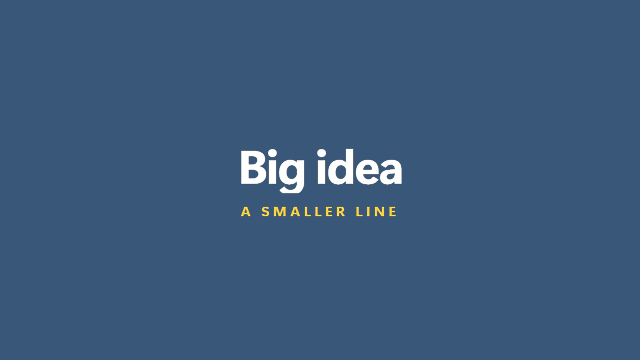

Title whose lines rise out of an invisible mask, one after the other (editorial, kinetic). Default length 3.5 s. Parameters: `titolo`, `sottotitolo`, `colore`.

### `glitch_title`

Uppercase title that tears into red and cyan slices for a moment, then settles. Default length 2.5 s. Parameters: `titolo`, `colore`.

### `word_cycle`

A fixed phrase and one word that rolls through options and stops on the last ('We make FILMS'). Default length 4 s. Parameters: `prefisso`, `voci`, `colore`.

### `countdown`

Big numbers that replace each other: '3, 2, 1, GO'. The last one stays. Default length 3.6 s. Parameters: `voci`, `colore`.

### `logo_shine`

Wordmark that lands and gets swept by a glint of light, with an optional tagline. Default length 3.5 s. Parameters: `testo`, `sottotitolo`, `colore`.

## Text

### `caption_pill`

Short caption in a rounded pill, at the bottom or the top. Default length 3 s. Parameters: `testo`, `posizione`, `sfondo`.

### `date_badge`

Small tag in a top corner for years, dates, counters: 'YEAR 20', '+50 YEARS'. Default length 3 s. Parameters: `testo`, `posizione`, `colore`.

### `quote`

Serif quote on a darkened frame, with the author below. Default length 5 s. Parameters: `testo`, `autore`, `colore`.

### `kinetic_words`

A sentence whose words pop in one after the other; *word* is highlighted. Default length 4 s. Parameters: `testo`, `colore`.

### `section_label`

Small tag in the top-left corner naming the part: 'Chapter 1 - The hook'. Default length 3 s. Parameters: `testo`, `colore`.

### `typewriter`

One line typed out letter by letter, with a blinking cursor (monospace). Default length 4 s. Parameters: `testo`, `colore`.

### `ticker`

News-style bar at the bottom with a label and text scrolling across it. Default length 8 s. Parameters: `testo`, `etichetta`, `sfondo`, `colore`.

### `sticker_text`

Loud rotated label that slams in the middle of the frame ('WAIT FOR IT'). Default length 2 s. Parameters: `testo`, `angolo`, `colore`.

### `speech_bubble`

White speech bubble placed at x, y (% of the frame), popping in. Default length 3 s. Parameters: `testo`, `x`, `y`, `colore`.

### `handle_tag`

Small @handle watermark in the bottom-right corner. Default length 6 s. Parameters: `handle`, `colore`.

### `chat_messages`

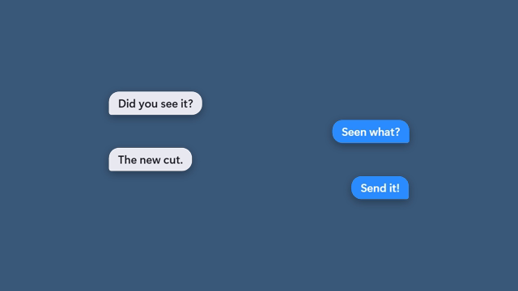

Messenger-style bubbles popping in, alternating left (received) and right (sent). 1-5 messages. Default length 5 s. Parameters: `voci`, `colore`.

### `notification_toast`

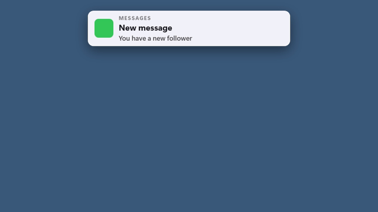

Phone-style notification card dropping from the top. Default length 4 s. Parameters: `app`, `titolo`, `testo`, `colore`.

### `location_pin`

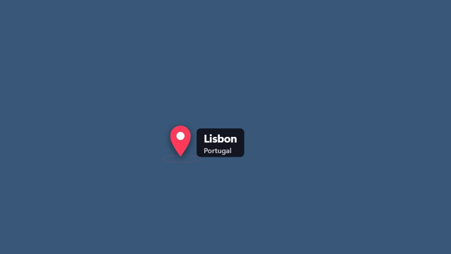

Map pin dropping at x, y (% of the frame, the tip) with a ripple and a place label. Default length 4 s. Parameters: `luogo`, `dettaglio`, `x`, `y`, `colore`.

## Data

### `counter`

Big number that counts from one value to another and holds. Default length 4 s. Parameters: `da`, `a`, `decimali`, `prefisso`, `suffisso`, `etichetta`, `colore`.

### `bar_chart`

Horizontal bar chart on a dark panel; bars grow one after the other. Default length 5 s. Parameters: `dati`, `titolo`, `colore`.

### `progress_ring`

Ring that fills to a percentage while the number counts up. Default length 4 s. Parameters: `valore`, `etichetta`, `colore`.

### `stat_card`

Big figure on a card with a label and an optional delta chip ('+12%'). Default length 4 s. Parameters: `valore`, `etichetta`, `delta`, `colore`.

### `steps`

Numbered steps joined by a line, revealed one after the other (2-6). Default length 5 s. Parameters: `voci`, `colore`.

### `comparison`

Two panels side by side joined by a VS badge. Default length 5 s. Parameters: `sinistra`, `sinistra_testo`, `destra`, `destra_testo`, `colore`.

### `list_reveal`

Panel with a title and bullet points appearing one by one (1-7). Default length 5 s. Parameters: `titolo`, `voci`, `colore`.

### `donut_chart`

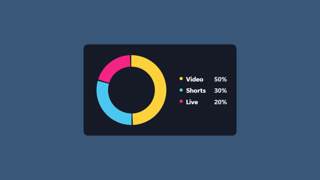

Donut chart sweeping round, with a legend of shares. 1-10 label:value pairs. Default length 5 s. Parameters: `dati`, `titolo`, `colore`.

### `line_chart`

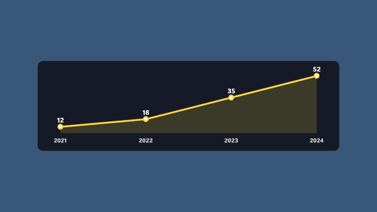

Line chart drawn left to right with points popping on it. 2-10 label:value pairs. Default length 5 s. Parameters: `dati`, `titolo`, `colore`.

### `timeline`

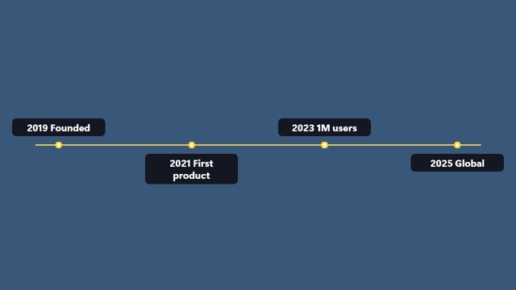

Horizontal timeline that draws itself, with milestones above and below. 2-6 items. Default length 6 s. Parameters: `voci`, `colore`.

### `rating_stars`

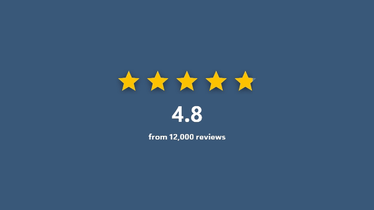

Five stars filling up to a rating, with the number and a caption. Default length 3.5 s. Parameters: `valore`, `etichetta`, `colore`.

### `price_tag`

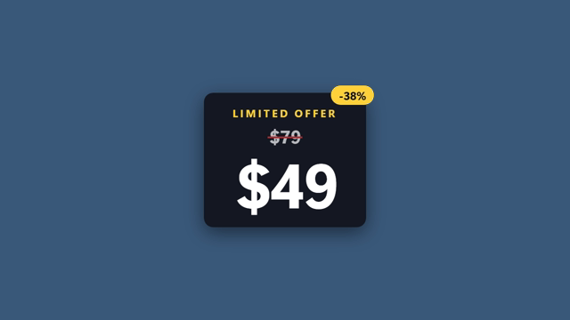

Price card: the old price gets struck out, the new one pops, with an optional badge. Default length 4 s. Parameters: `prezzo`, `vecchio`, `etichetta`, `badge`, `colore`.

### `checklist`

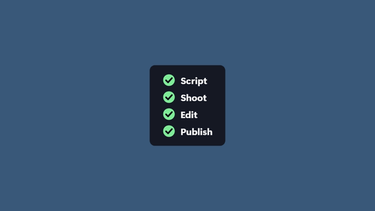

Panel whose items get ticked one by one, each tick drawn by hand. 1-6 items. Default length 5 s. Parameters: `titolo`, `voci`, `colore`.

## Emphasis

### `highlight_box`

Pulsing frame that darkens the rest to point at one area (x, y, size in % of the frame). Default length 3 s. Parameters: `x`, `y`, `larghezza`, `altezza`, `etichetta`, `colore`.

### `progress_bar`

Thin bar along an edge that fills over the whole clip. Default length 10 s. Parameters: `posizione`, `colore`.

### `arrow_pointer`

Bobbing arrow whose tip is at x, y (% of the frame); angle = where it points. Default length 3 s. Parameters: `x`, `y`, `angolo`, `etichetta`, `colore`.

### `circle_highlight`

Ellipse drawn around an area, like circling it with a pen (x, y, size in %). Default length 3 s. Parameters: `x`, `y`, `larghezza`, `altezza`, `colore`.

### `marker_highlight`

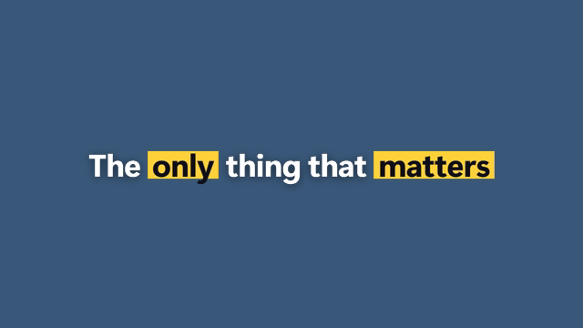

A sentence where *starred* words get a marker swipe behind them, one after the other. Default length 4 s. Parameters: `testo`, `colore`.

### `subscribe_button`

Subscribe button that gets pressed, turns into 'Subscribed' and rings its bell. Default length 4 s. Parameters: `testo`, `fatto`, `colore`.

### `alert_banner`

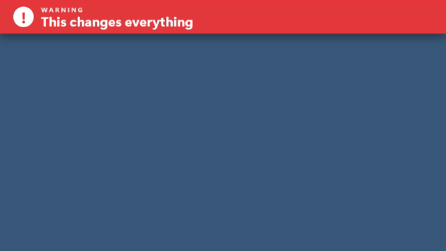

Bar dropping from the top with a blinking '!' (warning, breaking, update). Default length 3.5 s. Parameters: `testo`, `etichetta`, `colore`.

## Transitions

### `color_wipe`

Transition: a flat color sweeps across the frame and out again. The cut between scenes goes at the middle of the clip. Default length 1.2 s. Parameters: `colore`, `direzione`.

### `flash_frame`

Transition: a short flash of color, for impact or a hard beat. Default length 0.4 s. Parameters: `colore`.

### `iris_wipe`

Transition: the frame closes to a color through an iris and opens again. Cut at the middle. Default length 1.2 s. Parameters: `colore`, `x`, `y`.

### `blinds_wipe`

Transition: vertical blinds close in a ripple, stay shut for a beat, then open. Cut at the middle. Default length 1.2 s. Parameters: `colore`, `strisce`.

## Style

### `letterbox`

Cinema bars sliding in at the top and bottom. Default length 6 s. Parameters: `altezza`.

### `vignette`

Soft dark edges that fade in, to pull the eye to the center. Default length 6 s. Parameters: `forza`.

### `film_grain`

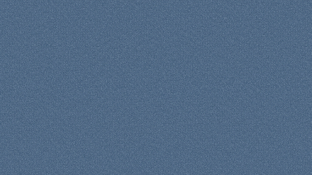

Moving film grain over the whole frame (subtle; set the clip blend to overlay or soft light if you like). Default length 6 s. Parameters: `forza`.

### `light_leak`

Warm light drifting across the frame once, like a leak on film (set the clip blend to screen). Default length 3 s. Parameters: `colore`.

### `scanlines`

CRT scanlines with a slow rolling bar: retro monitor, VHS, found footage. Default length 6 s. Parameters: `forza`.

### `viewfinder`

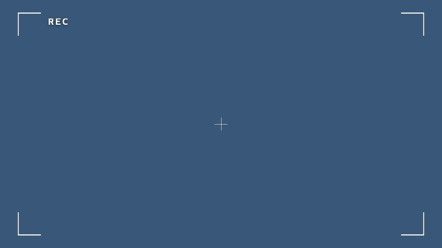

Camera viewfinder: corner brackets, a blinking REC dot and a crosshair. Default length 6 s. Parameters: `etichetta`, `colore`.
