# Motion graphics blocks

Rendered by vedit itself (`python scripts/blocchi_galleria.py`), default parameters. Use them with `list_blocks` / `add_block`.

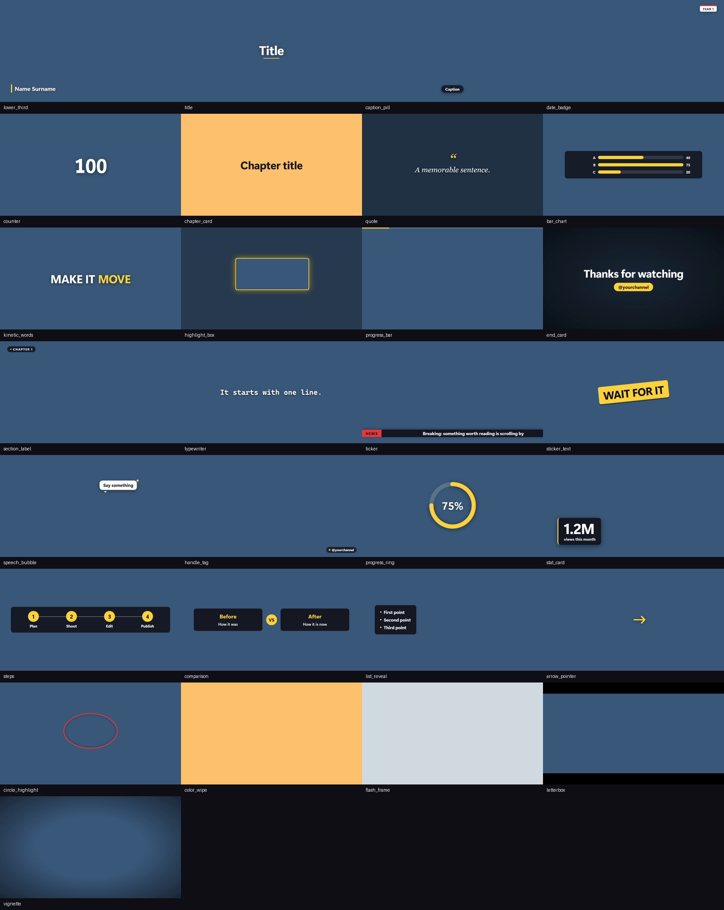

## Titles

### `lower_third`

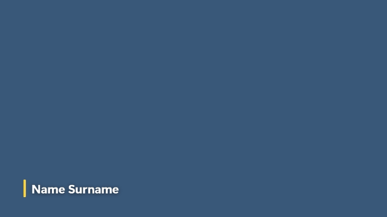

Name and role bar at the bottom left, with an accent line. Default length 4 s. Parameters: `nome`, `ruolo`, `colore`.

### `title`

Big centered title with an accent rule and optional subtitle. Default length 3 s. Parameters: `titolo`, `sottotitolo`, `colore`.

### `chapter_card`

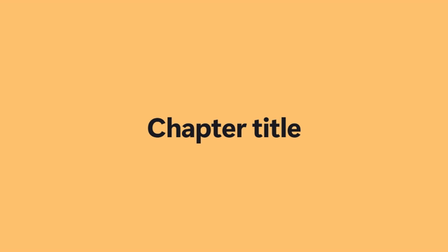

Full-frame chapter card on a flat color: it wipes in and out. Opaque: put it in the timeline between scenes. Default length 2.5 s. Parameters: `titolo`, `numero`, `etichetta`, `sfondo`, `testo_colore`.

### `end_card`

Closing screen: darkened frame, big title and a pulsing @handle pill. Default length 5 s. Parameters: `titolo`, `handle`, `colore`.

## Text

### `caption_pill`

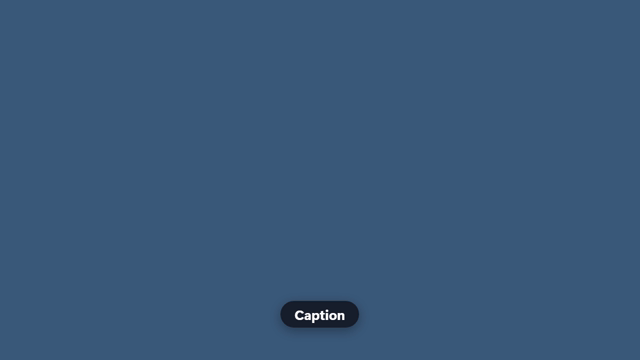

Short caption in a rounded pill, at the bottom or the top. Default length 3 s. Parameters: `testo`, `posizione`, `sfondo`.

### `date_badge`

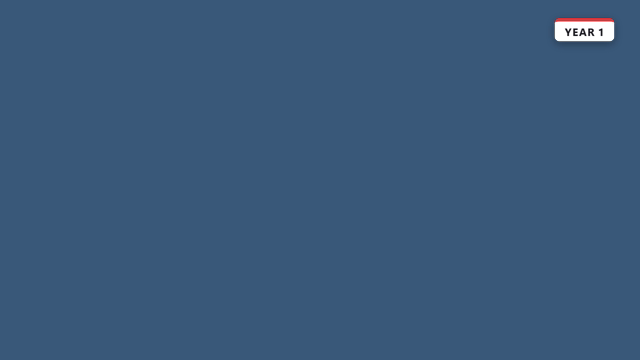

Small tag in a top corner for years, dates, counters: 'YEAR 20', '+50 YEARS'. Default length 3 s. Parameters: `testo`, `posizione`, `colore`.

### `quote`

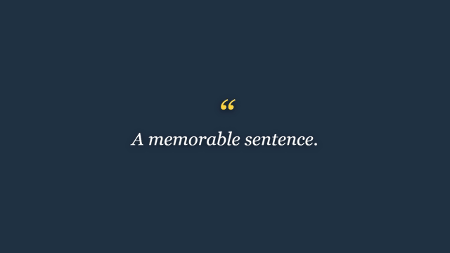

Serif quote on a darkened frame, with the author below. Default length 5 s. Parameters: `testo`, `autore`, `colore`.

### `kinetic_words`

A sentence whose words pop in one after the other; *word* is highlighted. Default length 4 s. Parameters: `testo`, `colore`.

### `section_label`

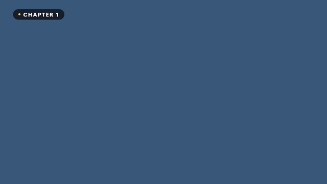

Small tag in the top-left corner naming the part: 'Chapter 1 - The hook'. Default length 3 s. Parameters: `testo`, `colore`.

### `typewriter`

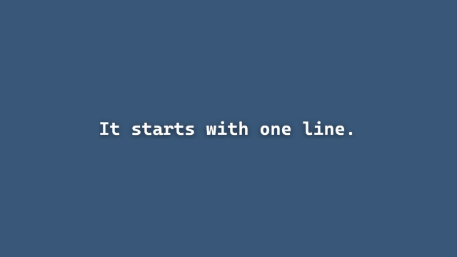

One line typed out letter by letter, with a blinking cursor (monospace). Default length 4 s. Parameters: `testo`, `colore`.

### `ticker`

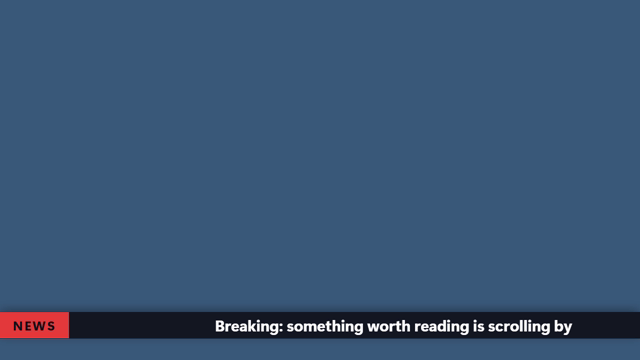

News-style bar at the bottom with a label and text scrolling across it. Default length 8 s. Parameters: `testo`, `etichetta`, `sfondo`, `colore`.

### `sticker_text`

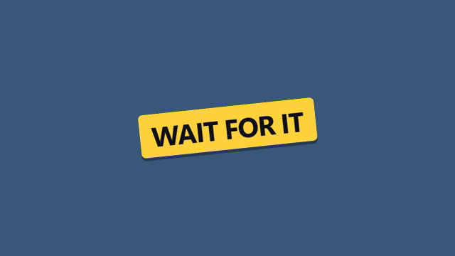

Loud rotated label that slams in the middle of the frame ('WAIT FOR IT'). Default length 2 s. Parameters: `testo`, `angolo`, `colore`.

### `speech_bubble`

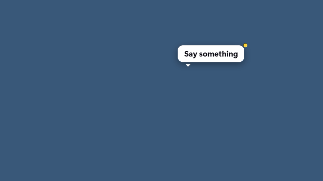

White speech bubble placed at x, y (% of the frame), popping in. Default length 3 s. Parameters: `testo`, `x`, `y`, `colore`.

### `handle_tag`

Small @handle watermark in the bottom-right corner. Default length 6 s. Parameters: `handle`, `colore`.

## Data

### `counter`

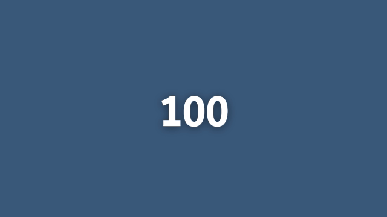

Big number that counts from one value to another and holds. Default length 4 s. Parameters: `da`, `a`, `decimali`, `prefisso`, `suffisso`, `etichetta`, `colore`.

### `bar_chart`

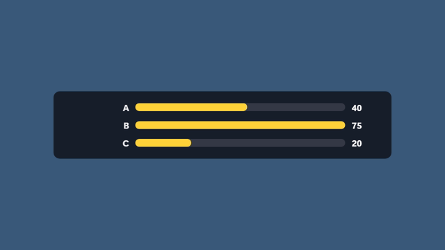

Horizontal bar chart on a dark panel; bars grow one after the other. Default length 5 s. Parameters: `dati`, `titolo`, `colore`.

### `progress_ring`

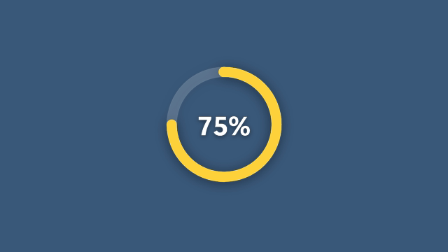

Ring that fills to a percentage while the number counts up. Default length 4 s. Parameters: `valore`, `etichetta`, `colore`.

### `stat_card`

Big figure on a card with a label and an optional delta chip ('+12%'). Default length 4 s. Parameters: `valore`, `etichetta`, `delta`, `colore`.

### `steps`

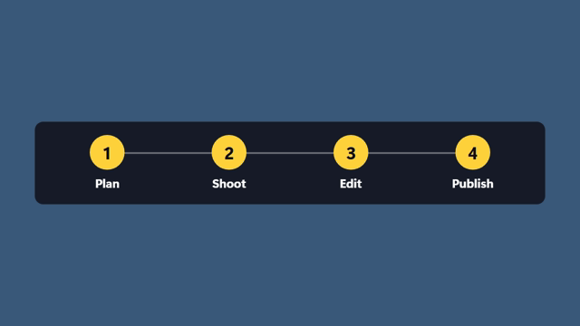

Numbered steps joined by a line, revealed one after the other (2-6). Default length 5 s. Parameters: `voci`, `colore`.

### `comparison`

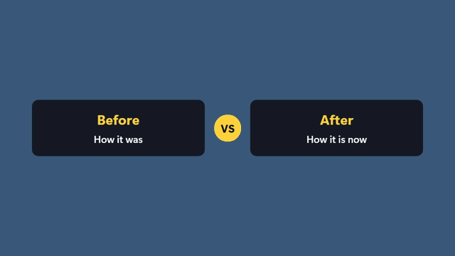

Two panels side by side joined by a VS badge. Default length 5 s. Parameters: `sinistra`, `sinistra_testo`, `destra`, `destra_testo`, `colore`.

### `list_reveal`

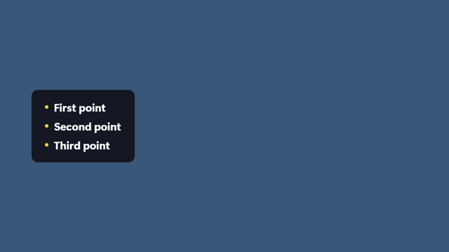

Panel with a title and bullet points appearing one by one (1-7). Default length 5 s. Parameters: `titolo`, `voci`, `colore`.

## Emphasis

### `highlight_box`

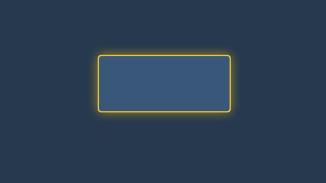

Pulsing frame that darkens the rest to point at one area (x, y, size in % of the frame). Default length 3 s. Parameters: `x`, `y`, `larghezza`, `altezza`, `etichetta`, `colore`.

### `progress_bar`

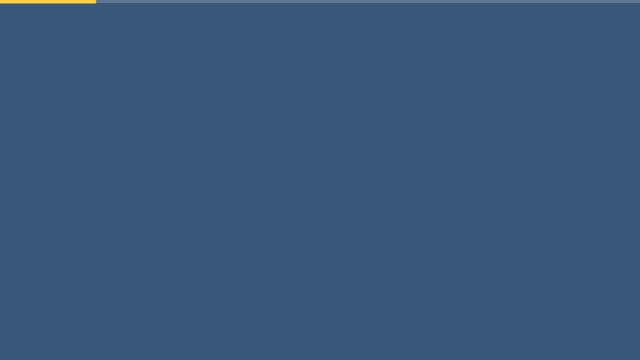

Thin bar along an edge that fills over the whole clip. Default length 10 s. Parameters: `posizione`, `colore`.

### `arrow_pointer`

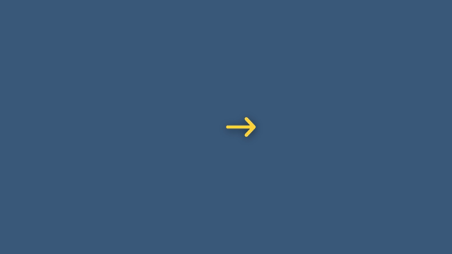

Bobbing arrow whose tip is at x, y (% of the frame); angle = where it points. Default length 3 s. Parameters: `x`, `y`, `angolo`, `etichetta`, `colore`.

### `circle_highlight`

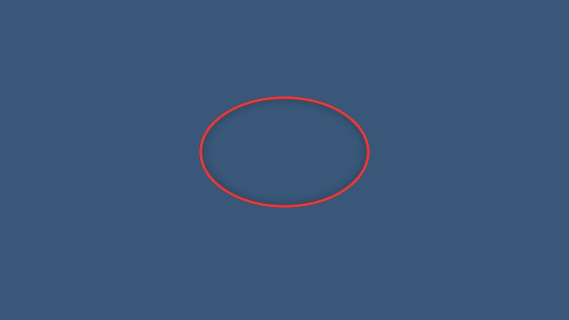

Ellipse drawn around an area, like circling it with a pen (x, y, size in %). Default length 3 s. Parameters: `x`, `y`, `larghezza`, `altezza`, `colore`.

## Transitions

### `color_wipe`

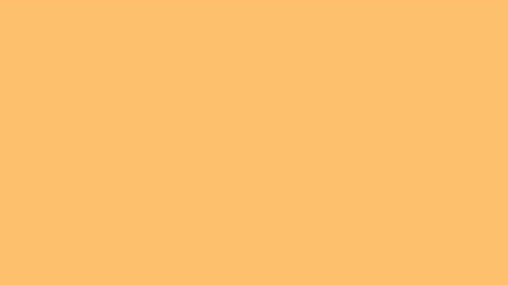

Transition: a flat color sweeps across the frame and out again. The cut between scenes goes at the middle of the clip. Default length 1.2 s. Parameters: `colore`, `direzione`.

### `flash_frame`

Transition: a short flash of color, for impact or a hard beat. Default length 0.4 s. Parameters: `colore`.

## Style

### `letterbox`

Cinema bars sliding in at the top and bottom. Default length 6 s. Parameters: `altezza`.

### `vignette`

Soft dark edges that fade in, to pull the eye to the center. Default length 6 s. Parameters: `forza`.
